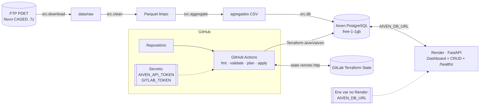

# GAP Salarial e Funil de Liderança Corporativa

Pipeline de dados em nuvem a custo zero sobre os microdados do **Novo CAGED** (MTE/PDET), com recorte
interseccional **sexo × raça/cor** (ODS 5 e ODS 18), e aplicação CRUD de **trajetórias até a liderança**
sobre PostgreSQL gerenciado na Aiven, provisionado por Terraform e GitHub Actions.

**Problema:** disparidade de rendimento médio e de tempo de ascensão funcional entre grupos de sexo e raça/cor.

## Arquitetura



| Camada | Tecnologia | Onde |
|---|---|---|
| Ingestão e ETL | Python, pandas, pyarrow | `src/download.py`, `src/clean.py`, `src/aggregate.py` |
| Banco | Aiven for PostgreSQL (free) | `src/db.py` (modelo das tabelas e carga) |
| IaC | Terraform `aiven/aiven` | `infra/main.tf`, `infra/variables.tf`, `infra/outputs.tf` |
| Pipeline | GitHub Actions | `.github/workflows/pipeline.yml` |
| API, CRUD e health check | FastAPI no Render | `src/api/main.py`, `src/api/cadastro.html` |
| Dashboard | HTML + Apache ECharts servido pela API | `src/api/dashboard.html` |

## Dashboard

Em `/`. Filtros dinâmicos (ano, UF, sexo, raça/cor, grande grupo CBO), clique no mapa de calor ou numa UF para filtrar, e métricas:

1. Salário médio de admissão (média ponderada pelo número de admissões)
2. Gap salarial de gênero (mulheres vs homens)
3. Gap salarial racial (pessoas negras vs brancas)
4. Gap interseccional (mulheres negras vs homens brancos)
5. Percentual de admissões em cargos de liderança
6. Saldo de empregos

Abas: mapa de calor sexo × raça, salário por grande grupo CBO, acesso à liderança e composição ocupacional
por grupo, evolução mensal do saldo, gap de gênero por UF e tempo de ascensão funcional (a partir do CRUD).

## CRUD: trajetórias até a liderança

O Novo CAGED público não identifica o trabalhador, então não mede o tempo até a liderança. O CRUD registra
trajetórias e o dashboard calcula esse tempo por grupo.

| Campo | Tipo | Regra |
|---|---|---|
| nome | texto | obrigatório, até 120 |
| sexo | status | Homem, Mulher |
| raca_cor | status | Branca, Preta, Parda, Amarela, Indígena |
| cargo | texto | obrigatório, até 120 |
| salario | número | maior que zero |
| data_admissao | data | obrigatória |
| data_lideranca | data | opcional, não anterior à admissão |

Rotas: `GET /` (dashboard), `GET /cadastro` (tela do CRUD), `GET /api/agregados`, `GET/POST /colaboradores`, `PUT/DELETE /colaboradores/{id}`, `GET /healthz`
(200 com banco ativo, 503 sem conexão), `GET /docs`.

## Modelo de dados

| Tabela | Chave primária | Medidas |
|---|---|---|
| `agg_gap_salarial` | ano, uf, sexo, raca_cor_agrupada, grande_grupo_nome | n, salario_medio, salario_mediano |
| `agg_funil_lideranca` | ano, uf, sexo, raca_cor_agrupada, grande_grupo_nome | admissoes, pct_no_grupo_demografico |
| `agg_perfil_mensal` | competencia, uf, sexo, raca_cor_agrupada, lideranca | saldo, movs |
| `colaboradores` | id | campos do CRUD |

Para caber no 1 GB gratuito, só os agregados vão para a Aiven; o microdado limpo fica em Parquet local.
Carga atual: Novo CAGED 2025 completo (CAGEDMOV + CAGEDFOR), cerca de 51 milhões de movimentações. Declarações fora do prazo de 2024 aparecem como ano 2024 parcial.

## Dicionário de variáveis (base tratada)

| Coluna | Origem no Novo CAGED | Descrição |
|---|---|---|
| ano, mes, competencia | competênciamov | AAAAMM da movimentação |
| uf | uf | Sigla da UF (código IBGE mapeado) |
| municipio_cod | município | Código IBGE do município |
| cnae_secao | seção | Seção CNAE 2.0 |
| cbo, cbo_grande_grupo, grande_grupo_nome | cbo2002ocupação | CBO-2002 com 6 dígitos, 1º dígito e nome |
| lideranca | derivada | Verdadeiro se grande grupo 1 (dirigentes e gerentes) |
| sexo | sexo | 1 Homem, 3 Mulher (9 descartado) |
| raca_cor | raçacor | 1 Branca, 2 Preta, 3 Parda, 4 Amarela, 5 Indígena, 6 Não informada, 9 Não identificada |
| raca_cor_agrupada | derivada | Branca, Negra (preta+parda), Amarela, Indígena, Não informada |
| idade, grau_instrucao_cod, horas_contratuais, tam_estab_cod | idem | Atributos do vínculo |
| saldo, tipo_mov | saldomovimentação | +1 admissão, −1 desligamento |
| salario | salário | Salário em R$; fora de R$ 100 a R$ 150 mil vira nulo |
| fora_prazo | indicadordeforadoprazo | Declaração fora do prazo (CAGEDFOR) |

Tratamento: leitura em blocos de 1 milhão de linhas, tipagem numérica, nulos para salários inválidos,
salários fora de R$ 100 a R$ 150 mil anulados, descarte de sexo não identificado, CBO normalizado para 6 dígitos. O salário analisado é o de admissão.

## Como reproduzir

### 1. Contas e segredos (sem cartão)
1. Aiven: criar conta e projeto; gerar token em *User profile → Tokens*.
2. GitLab: criar projeto vazio (guarda o state) e um *Personal Access Token* com escopo `api`.
3. GitHub, em *Settings → Secrets and variables → Actions*:
   - Secrets: `AIVEN_API_TOKEN`, `GITLAB_TOKEN`
   - Variables: `AIVEN_PROJECT`, `EQUIPE` (número da equipe), `GITLAB_USER`,
     `TF_STATE_URL` = `https://gitlab.com/api/v4/projects/<id do projeto>/terraform/state/caged`
4. GitHub, em *Settings → Environments*: criar `production` com revisor obrigatório.

### 2. Infraestrutura
- Todo push roda testes, `terraform fmt -check` e `validate`; todo pull request roda `plan`.
- Push na branch padrão roda `apply` após aprovação no Environment `production`.
- Serviço criado: `equipe-<EQUIPE>-pg`, com o database `caged` e o usuário `app`.
- Destruir: *Actions → pipeline → Run workflow* com `destroy` marcado.
- A URL de conexão sai como output sensível: `terraform output -raw aiven_db_url`
  (ou copie host, porta e senha do usuário `app` no console da Aiven).

### 3. Dados
```bash
pip install -r requirements.txt
make download
make clean
make aggregate
AIVEN_DB_URL="postgresql://app:<senha>@<host>:<porta>/caged?sslmode=require" make load
```
Sem `AIVEN_DB_URL` tudo roda num SQLite local (`data/local.db`). `make sample` gera dados sintéticos para teste offline.

### 4. Publicação
Render (*New → Web Service*): build `pip install -r requirements.txt`,
start `uvicorn src.api.main:app --host 0.0.0.0 --port $PORT`, health check `/healthz`,
variável `AIVEN_DB_URL`. A mesma URL publica o dashboard (`/`) e o CRUD (`/cadastro`).

### 5. Local
```bash
make test
make api
```
Abra http://localhost:8000 (dashboard) e http://localhost:8000/cadastro (CRUD).

## ADR-001: PostgreSQL gerenciado na Aiven

**Contexto:** a aplicação e o dashboard precisam de um banco relacional acessível pela internet, sem custo,
sem instalação local e operável por uma equipe pequena.

| Critério | Aiven PostgreSQL (free) | PostgreSQL próprio em VM | SQLite no Render |
|---|---|---|---|
| Custo | zero, sem cartão | VM gratuita exige cartão | zero |
| Instalação e patches | feitos pelo provedor | pela equipe | não se aplica |
| Backup e TLS | inclusos | configurar manualmente | inexistente |
| Persistência | sim | sim | perdida a cada deploy |
| Terraform | provider oficial | só a VM | não |

**Decisão:** Aiven for PostgreSQL no plano gratuito, criado por Terraform.

**Consequências:** limite de 1 GB (por isso só agregados são carregados), 20 conexões e possível desligamento
por inatividade, que exige religar o serviço pelo console antes da demonstração.

## Limitações metodológicas
- O salário do Novo CAGED é o de contratação, não o rendimento do estoque (que está na RAIS).
- O funil é transversal: participação das admissões em cargos de liderança por grupo.
- Meses recentes são revisados por declarações fora do prazo (`CAGEDFOR`).

Fonte: `ftp://ftp.mtps.gov.br/pdet/microdados/NOVO CAGED/{ano}/{ano}{mes}/CAGEDMOV{ano}{mes}.7z`


alunos:

João Daniel De Cerqueira Lisboa 

Gabriel Coelho de Jesus Lopes
